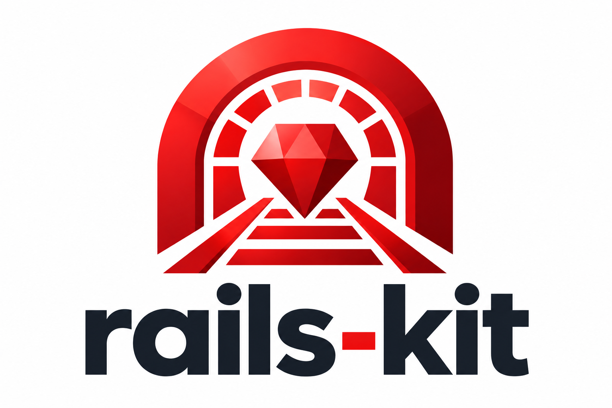

<p align="center">
  
</p>

<p align="center"><strong>Rails skills for Claude Code and Codex.<br>Audit your app, speed up tests, and plan upgrades with evidence.</strong></p>

<p align="center">
  <a href="https://github.com/svyatov/rails-kit/actions/workflows/validate.yml"></a>
  <a href="#claude-code"></a>
  <a href="#codex"></a>
  <a href="LICENSE"></a>
</p>

<p align="center">
  <a href="#installation">Install</a> ·
  <a href="#skills">Skills</a> ·
  <a href="#usage">Usage</a> ·
  <a href="CONTRIBUTING.md">Contribute</a> ·
  <a href="CHANGELOG.md">Changelog</a>
</p>

- **Install only what you need.** Each skill is a separate plugin, with the same workflow in both agents.
- **Run it when you choose.** Every skill requires explicit invocation. Audits report findings first; fixes require your authorization.
- **Keep Rails conventions.** Skills use version-specific Rails and Ruby documentation, identify optional tools, and require evidence for proposed changes.

## Installation

Register the marketplace and install the skill with your agent's CLI.

### Claude Code

```sh
claude plugin marketplace add svyatov/rails-kit
claude plugin install setup-hyperdrive@rails-kit
```

### Codex

```sh
codex plugin marketplace add svyatov/rails-kit
codex plugin add setup-hyperdrive@rails-kit
```

Replace `setup-hyperdrive@rails-kit` with any plugin from the [skill catalog](#skills). To install from a local checkout, run the marketplace command from its root with `.` instead of `svyatov/rails-kit`.

## Usage

Open your Rails project in your agent and invoke the installed skill with a request. For example, after installing `audit-jobs@rails-kit`:

**Claude Code**

```text
/audit-jobs:audit-jobs Audit app/jobs for retries and duplicate side effects. Report findings before making changes.
```

**Codex**

```text
$audit-jobs Audit app/jobs for retries and duplicate side effects. Report findings before making changes.
```

The invocation format is `/plugin-name:skill-name` in Claude Code and `$skill-name` in Codex. Plugin and skill names match throughout this collection. For the installation example above, use `/setup-hyperdrive:setup-hyperdrive` or `$setup-hyperdrive`.

## Skills

| Skill | Description |
| --- | --- |
| [setup-hyperdrive](plugins/setup-hyperdrive/skills/setup-hyperdrive/SKILL.md) | Set up and maintain Rails Hyperdrive in a Rails project: development-only gems, companion skills, MCP access, and safe content sync. |
| [optimize-tests](plugins/optimize-tests/skills/optimize-tests/SKILL.md) | Profile and speed up Rails tests with TestProf, targeted side-effect controls, lean factories, and safely shared fixtures. |
| [audit-active-record-concurrency](plugins/audit-active-record-concurrency/skills/audit-active-record-concurrency/SKILL.md) | Audit concurrent Active Record writes for duplicate records, lost updates, and broken database invariants. |
| [audit-n-plus-one](plugins/audit-n-plus-one/skills/audit-n-plus-one/SKILL.md) | Audit Rails query growth, locate N+1 queries, and verify loading or batching fixes with regression coverage. |
| [audit-transactions](plugins/audit-transactions/skills/audit-transactions/SKILL.md) | Audit Rails transaction boundaries, rollback behavior, exception handling, and external side effects. |
| [audit-http-clients](plugins/audit-http-clients/skills/audit-http-clients/SKILL.md) | Audit outbound Ruby HTTP clients for timeout budgets, retry safety, error handling, secret leakage, and failure isolation. |
| [audit-api-contracts](plugins/audit-api-contracts/skills/audit-api-contracts/SKILL.md) | Audit Rails API contracts against request behavior, serializers, OpenAPI schemas, and compatibility requirements. |
| [write-rubocop-cops](plugins/write-rubocop-cops/skills/write-rubocop-cops/SKILL.md) | Write and test custom RuboCop cops for Ruby and Rails conventions, with version-aware rules and safe autocorrection. |
| [audit-jobs](plugins/audit-jobs/skills/audit-jobs/SKILL.md) | Audit Ruby and Rails jobs for retries, duplicate effects, delivery gaps, transaction timing, concurrency, and tenant fairness. |
| [upgrade-rails](plugins/upgrade-rails/skills/upgrade-rails/SKILL.md) | Assess and upgrade Rails applications with version-specific findings, configuration previews, dependency checks, and verified incremental upgrades. |
| [upgrade-ruby](plugins/upgrade-ruby/skills/upgrade-ruby/SKILL.md) | Assess and upgrade Ruby versions in Bundler and Rails applications with compatibility audits, toolchain updates, and verification. |

To install the test optimization skill, replace `setup-hyperdrive@rails-kit` with `optimize-tests@rails-kit` in the install command. Invoke `/optimize-tests:optimize-tests` or `$optimize-tests` to profile and speed up the application's test suite. Its guides cover all optimization techniques from the [Evil Martians case study](https://evilmartians.com/chronicles/railing-against-time-tools-and-techniques-that-got-us-5x-faster-results), with measured verification and test-isolation checks.

For Rails upgrades, install `upgrade-rails@rails-kit` and invoke `/upgrade-rails:upgrade-rails` or `$upgrade-rails` with the target version. The skill supports readiness assessments, configuration previews, and implementation, with source references preserved from three MIT-licensed upstream projects.

## Contributing

See [CONTRIBUTING.md](CONTRIBUTING.md) for repository layout, skill requirements, and validation commands. Bug reports, skill proposals, and questions go to [GitHub Issues](https://github.com/svyatov/rails-kit/issues).

## Sources and license

Rails Kit is [MIT licensed](LICENSE). Individual skills keep their source references alongside the instructions. The Rails upgrade skill also preserves [upstream provenance and licenses](plugins/upgrade-rails/skills/upgrade-rails/sources.json).

Rails Kit is an independent project, not an official Rails, Anthropic, or OpenAI product.
